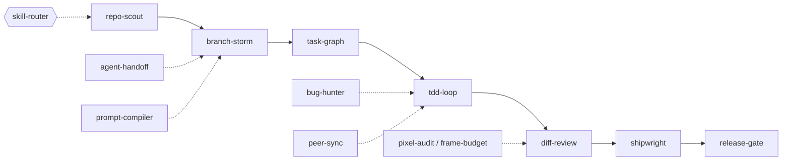

# Skills

**14 skills that make your AI coding agent work like a careful engineer, from the first idea to the release.**

Install them once. Then you can tell your agent, in plain words, to plan a feature, build it test-first, fix a bug, review your code, open a pull request or check a release, and it follows a proven routine instead of improvising.

They work in Claude Code, Codex, Cursor and other agents that support the `SKILL.md` format.

## What you get, in plain words

- **Your agent knows your project.** One setup step records your stack, commands, git host and conventions. No skill asks you again.
- **It follows a routine, not a guess.** Debugging starts by reproducing the bug. Building starts with a failing test. Reviews cite exact lines.
- **Every result is saved as a markdown file in your project**, in a folder named after the skill. A teammate, or the same agent tomorrow, can read it and continue.
- **Nothing risky happens unasked.** No commit, push, PR, tag, deploy or pull unless you tell it to.
- **Works for a team.** `peer-sync` tells you what your partners pushed while you worked.

## See it in action

You type:

```text
Use shipwright: create branch feat/ENG-42-cart-rounding, commit my changes with
conventional commits, push, and open a PR into main. Ticket ENG-42 (Linear).
Open it as a draft.
```

The skill:

1. Reads your project profile (`AGENTS.md`) and your latest review notes.
2. Checks your diff for secrets, debug leftovers and unrelated changes, then runs your lint and tests.
3. Creates the branch, writes conventional commits (`fix(cart): round totals to cents`).
4. Writes the PR body to `.agent-notes/shipwright/feat-eng-42-cart-rounding.body.md` and shows you the plan.
5. Pushes and opens a draft PR on GitHub, GitLab or Bitbucket, linked to `ENG-42`.

## Quick start

1. **Install** (see [Installation](#installation)).
2. **Run `repo-scout` once per project:**
   ```text
   Run repo-scout on this repo. It's a Flutter app, GitHub, tickets in Linear (key ENG), conventional commits.
   ```
   It writes `AGENTS.md`, which every agent reads.
3. **Not sure what to do next?**
   ```text
   Use skill-router. I just finished the spec, what now?
   ```

## How to write a prompt

Every prompt follows one formula: **skill name + goal + what the repo can't tell it + what "done" looks like.**

| Part | Why | Example |
|---|---|---|
| Skill name | Tells the agent which routine to follow. In Claude Code you can type `/skill-name`. | `Use bug-hunter:` |
| Goal | One sentence. | `checkout total is off by one cent` |
| Context | The facts only you know: repro steps, deadline, device, ticket, teammates. | `items 0.10, 0.20, 0.30 show 0.59, expected 0.60` |
| Done | How you will know it worked. | `with a regression test` |

You do not need all four every time. A skill asks one question at a time, with a default you can accept by saying "ok".

### Copy-paste prompts

| Skill | Prompt |
|---|---|
| `repo-scout` | `Run repo-scout on this repo. It's a Next.js app using pnpm, hosted on GitHub, tickets in Linear (key ENG), conventional commits.` |
| `branch-storm` | `Use branch-storm: we need offline support in the Flutter app. Two devs, three weeks, no backend changes. Give me options and a recommendation.` |
| `branch-storm` (challenge a plan) | `Use branch-storm in Grill mode: my plan is a local SQLite cache plus a sync queue. Poke holes in it.` |
| `task-graph` | `Use task-graph on the offline-sync decision. Tracker is Linear, key ENG. Each task must be demoable on its own and fit one session.` |
| `tdd-loop` | `Use tdd-loop for task 01: a user can add an item to the cart. Test through the cart widget, not private methods.` |
| `bug-hunter` | `Use bug-hunter: checkout total is off by one cent for three-item carts. Items 0.10, 0.20, 0.30 show 0.59, expected 0.60. Started after commit abc123.` |
| `pixel-audit` | `Use pixel-audit on this checkout screenshot. Audience is first-time mobile buyers. Is the pay button clear enough?` |
| `frame-budget` | `Use frame-budget on lib/features/products. The list drops frames when scrolling on a Pixel 6 in profile mode.` |
| `diff-review` | `Use diff-review on my branch against main. The spec is task 03. Focus on security and missing tests.` |
| `shipwright` | `Use shipwright: create branch feat/ENG-42-cart-rounding, commit my changes with conventional commits, push, and open a PR into main. Ticket ENG-42 (Linear). Open it as a draft.` |
| `release-gate` | `Use release-gate for the Android release 1.4.0 to Google Play. The last tag is v1.3.2.` |
| `peer-sync` | `Use peer-sync: what did Sam and Lena push since my last commit? Anything touching checkout?` |
| `agent-handoff` | `Use agent-handoff. The next session in Codex will finish the tests for task 02.` |
| `prompt-compiler` | `Use prompt-compiler: turn "add search to the products page" into a prompt for Codex.` |
| `skill-router` | `Use skill-router. I just finished the spec, what now?` |

### What `shipwright` accepts in your prompt

| You say | It does | If you don't say |
|---|---|---|
| `create branch feat/ENG-42-cart-rounding` | Creates exactly that branch | Builds a name from your profile and the ticket |
| `into main` | Uses that base branch | Uses your default branch |
| `ticket ENG-42 (Linear)` or `(Jira)` | Links the ticket in the PR | Uses your profile, or no ticket |
| `open it as a draft` | Opens a draft PR | Opens a ready PR |
| `request review from Lena` | Adds reviewers | None |
| `go ahead without asking` | Prints the plan, then continues | Waits for your yes at the plan |

It works the same on GitHub, GitLab and Bitbucket. It reads the host from your git remote.

## The skills

| Skill | What it does for you | What it saves |
|---|---|---|
| `skill-router` | Looks at your project and tells you which skill to run next | nothing |
| `repo-scout` | Detects your stack and writes `AGENTS.md` with verified commands, host, tracker and hot spots. Run once. | `repo-scout/overview.md` |
| `branch-storm` | Compares options or stress-tests your plan, then gives a recommendation. Keeps `GLOSSARY.md`. | `branch-storm/<topic>.md` |
| `prompt-compiler` | Turns a rough request into a precise prompt with checkable done-criteria | `prompt-compiler/<slug>.md` |
| `task-graph` | Turns a decision into a short spec and thin, ordered tasks | `task-graph/<feature>/` |
| `tdd-loop` | Builds one failing-test, then one fix, at a time | `tdd-loop/<task>.md` |
| `bug-hunter` | Reproduces the bug, ranks causes, fixes the root cause, adds a regression test | `bug-hunter/<date>-<slug>.md` |
| `pixel-audit` | Reviews a UI for hierarchy, accessibility and platform fit, with exact fixes | `pixel-audit/<screen>-<date>.md` |
| `frame-budget` | Finds slow or janky UI on mobile and web, with measurements and file:line | `frame-budget/<scope>-<date>.md` |
| `diff-review` | Reviews your own changes against the spec and best practice before the PR | `diff-review/<branch>.md` |
| `shipwright` | Creates the branch, writes commits, opens the PR on GitHub, GitLab or Bitbucket | `shipwright/<branch>.md` |
| `release-gate` | Gives a go or no-go for a release: version, changelog, migrations, rollback | `release-gate/<version>.md` |
| `peer-sync` | Summarizes what teammates pushed since your last commit and what overlaps with your work | `peer-sync/<date>.md` |
| `agent-handoff` | Writes a note so another agent or session can continue | `agent-handoff/<date>-<slug>.md` |

`skill-router`, `repo-scout`, `shipwright` and `agent-handoff` run only when you ask. The rest the agent can also reach for on its own.

## How they fit together



The solid line is the main path from idea to release. Each skill reads the previous skill's saved note, so the work carries forward. Use any skill on its own too.

## Working in a team

Two or three developers can share one repo and one set of skills. Everyone runs `repo-scout` once and commits `AGENTS.md`. Before you start or push, run `peer-sync`. It fetches (without pulling or merging), lists what each teammate pushed since your last commit, and warns you about files you both touched.

It can only see work that has been **pushed**. Local commits and uncommitted changes on a teammate's machine are invisible, and it says so.

## Works for any stack

The steps in every skill are the same for everyone. Stack knowledge lives in small files, `references/stacks/<stack>.md`, chosen from the `stack` value in your profile. Packs today: Flutter, Next.js and Laravel, plus a web pack for `frame-budget`. For another stack the skills still run with general checks, and you can add a pack by copying an existing one (see [SCOPE.md](./SCOPE.md)).

## Where your results go

```text
AGENTS.md                      your project profile, read by every agent
CLAUDE.md                      contains only: @AGENTS.md
GLOSSARY.md                    domain terms, kept by branch-storm
.agent-notes/
  repo-scout/overview.md
  branch-storm/  task-graph/  tdd-loop/  bug-hunter/  pixel-audit/  frame-budget/
  diff-review/  shipwright/  release-gate/  peer-sync/  agent-handoff/  prompt-compiler/
docs/adr/0001-<slug>.md        only for hard-to-reverse decisions
```

- Folders appear the first time a skill writes. Each run gets its own file, and old runs are never overwritten.
- Secrets are removed before anything is saved.
- Move the folder with `notes_dir` in the `AGENTS.md` profile. `repo-scout` asks once whether to commit the notes or git-ignore them.

## Installation

All skills:

```bash
npx skills@latest add kirubel12/skills
```

One skill:

```bash
npx skills@latest add kirubel12/skills/bug-hunter
```

Claude Code plugin (manifest included, install flow not yet tested):

```bash
/plugin marketplace add kirubel12/skills
/plugin install flowkit@flowkit
```

## FAQ

**Do I need all 14?** No. Install the set and use only what you need. `skill-router` helps when you are unsure.

**Will it commit or push by itself?** No. `shipwright` acts only when you ask, and it shows its plan first unless you tell it to go ahead.

**Does it work in Codex?** The skills use the shared format. The four run-only-when-asked skills ship an `agents/openai.yaml` so Codex does not trigger them on its own. This has not been tested in Codex yet.

**What if my stack isn't listed?** The workflow still applies. You only lose the stack-specific checks until a pack exists.

**Is it opinionated?** Yes: tests first, reproduce before you debug, conventional commits, small steps. [SCOPE.md](./SCOPE.md) explains what stays in and out.

## Evals

`evals/evals.json` holds realistic prompts and expectations for every skill, plus prompts that should and should not trigger it. Run each with and without the skill and compare.

## Credits

Built from ideas in public skill collections: the feedback-loop-first debugging approach, the router, thin-slice planning, lazy per-purpose file conventions and writing guidance in Matt Pocock's `mattpocock/skills`; the PR body format from Dex Horthy's show-me skill (HumanLayer); and the skill-writing guidance in Anthropic's `skill-creator`.

## License

MIT
