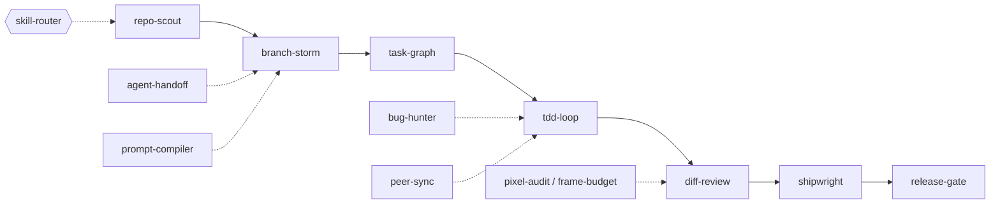

# Skills

Agent skills for the whole engineering workflow, from the first idea to the release. They use the open `SKILL.md` format, so they work in Claude Code, Codex, Cursor and other agents that support skills.

Install once and you have a skill for every stage. Not sure which to run? Ask `skill-router`.

## What goes wrong, and which skill fixes it

| The agent... | Skill |
|---|---|
| doesn't know your project, so it guesses commands and conventions | `repo-scout` |
| jumps to the first idea, or you commit to a plan nobody challenged | `branch-storm` |
| builds without a plan, so work can't be split or resumed | `task-graph` |
| writes code and tests afterwards, or tests that never failed | `tdd-loop` |
| guesses at causes instead of reproducing the bug | `bug-hunter` |
| ships a UI that is slow, janky or inaccessible | `pixel-audit`, `frame-budget` |
| opens a PR with bugs, secrets or unmet requirements | `diff-review` |
| writes vague commits and PR bodies | `shipwright` |
| releases without a version, changelog or rollback plan | `release-gate` |
| doesn't know what your teammates pushed while you worked | `peer-sync` |
| loses context when you switch session or agent | `agent-handoff` |
| turns a rough request into a vague task | `prompt-compiler` |

## The workflow



Each skill reads the previous skill's saved note and writes its own, so the set works as one flow. Use any skill on its own too.

## Skills

| Skill | Use it to | Invocation |
|---|---|---|
| `skill-router` | Find the next skill to run, from the project's notes | Manual |
| `repo-scout` | Detect the stack and write `AGENTS.md` with a verified project profile. Once per project | Manual |
| `branch-storm` | Compare options or stress-test a plan, ending in a recommendation. Keeps `GLOSSARY.md` | Automatic |
| `task-graph` | Turn a decision into a spec and thin end-to-end tasks with blocking edges | Automatic |
| `tdd-loop` | Build one red-green slice at a time | Automatic |
| `bug-hunter` | Debug with a red/green feedback loop, ranked hypotheses and a regression test | Automatic |
| `pixel-audit` | Review a UI: hierarchy, accessibility, platform fit | Automatic |
| `frame-budget` | Audit UI performance and quality against a frame or web-vitals budget | Automatic |
| `diff-review` | Review your own diff on standards and spec before the PR | Automatic |
| `shipwright` | Commit, push and open a PR or MR on GitHub, GitLab or Bitbucket | Manual |
| `release-gate` | Go or no-go release check: version, changelog, migrations, rollback | Automatic |
| `peer-sync` | Summarize what teammates pushed since your last commit, and what overlaps with your work | Automatic |
| `agent-handoff` | Write a note so another agent or session can continue | Manual |
| `prompt-compiler` | Turn a rough prompt into a precise, checkable one | Automatic |

"Manual" skills have side effects or are entry points, so they only run when you call them.

## Start a new project

1. Install the skills (below).
2. Run `repo-scout` once. It writes `AGENTS.md` (read by every agent) and a `CLAUDE.md` that points to it.
3. Run `skill-router` whenever you are unsure what comes next.

Every skill reads the Profile block in `AGENTS.md`, so none of them re-interviews you about stack, commands, git host, commit style or tracker.

## Works for any stack

The workflow in every skill is stack-neutral. Stack knowledge lives in `references/stacks/<stack>.md` and the skill picks the pack from the `stack` value in your profile. Packs today: Flutter, Next.js, Laravel (and a web pack for `frame-budget`). For another stack, the skills still run with general checks, and you can add a pack by copying an existing one. See `SCOPE.md`.

## Installation

All skills:

```bash
npx skills@latest add kirubel12/skills
```

One skill:

```bash
npx skills@latest add kirubel12/skills/bug-hunter
```

Claude Code plugin (manifest included, install flow not yet tested):

```bash
/plugin marketplace add kirubel12/skills
/plugin install flowkit@flowkit
```

Manual skills ship with `agents/openai.yaml` so Codex does not trigger them implicitly. Claude Code reads `disable-model-invocation` from the skill itself.

## Where output goes

Every skill saves its result as a markdown file in the project, in a folder named after the skill. A later session or another agent can read it and pick up where the last one stopped.

```text
AGENTS.md                      short profile, auto-read by every agent (repo-scout)
CLAUDE.md                      contains only: @AGENTS.md
GLOSSARY.md                    domain terms, kept by branch-storm
.agent-notes/
  repo-scout/overview.md       stack, commands, architecture, hot spots (updated in place)
  branch-storm/<topic>.md
  task-graph/<feature>/spec.md, tasks/01-<slug>.md
  tdd-loop/<task>.md
  bug-hunter/2026-11-19-<slug>.md
  pixel-audit/<screen>-<date>.md
  frame-budget/<scope>-<date>.md
  diff-review/<branch>.md
  shipwright/<branch>.md and <branch>.body.md
  release-gate/<version>.md
  peer-sync/<date>.md
  agent-handoff/<date>-<slug>.md
  prompt-compiler/<slug>-<date>.md
docs/adr/0001-<slug>.md        only for hard-to-reverse decisions (branch-storm offers it)
```

- Folders are created on first write. One file per run; earlier runs are never overwritten (`overview.md` is the one exception).
- Secrets are redacted before anything is written.
- Change the location with `notes_dir` in the `AGENTS.md` profile. `repo-scout` asks once whether to commit the notes or git-ignore them.
- Throwaway artifacts (prototypes, large logs, HTML reports) belong in the OS temp directory, not the repo.

## Working style

- Terse by default. Say "explain" or "go deep" for more.
- A skill asks at most one question at a time, and always offers a default you can accept with "ok".
- Audits have a quick mode for narrow questions and a full mode for reviews, and the full mode stops for your decision before implementing.
- Nothing external happens unasked: no commit, push, PR, tag, deploy or pull.

## Evals

`evals/evals.json` has realistic prompts and expectations for each skill, plus prompts that should and should not trigger it. Run each prompt with and without the skill and compare.

## Credits

Built from ideas in public skill collections: the feedback-loop-first debugging approach, the router, the thin-slice planning, the lazy per-purpose file conventions and the writing guidance in Matt Pocock's `mattpocock/skills`; the PR body format from Dex Horthy's show-me skill (HumanLayer); and the skill-writing guidance in Anthropic's `skill-creator`.

## License

MIT
