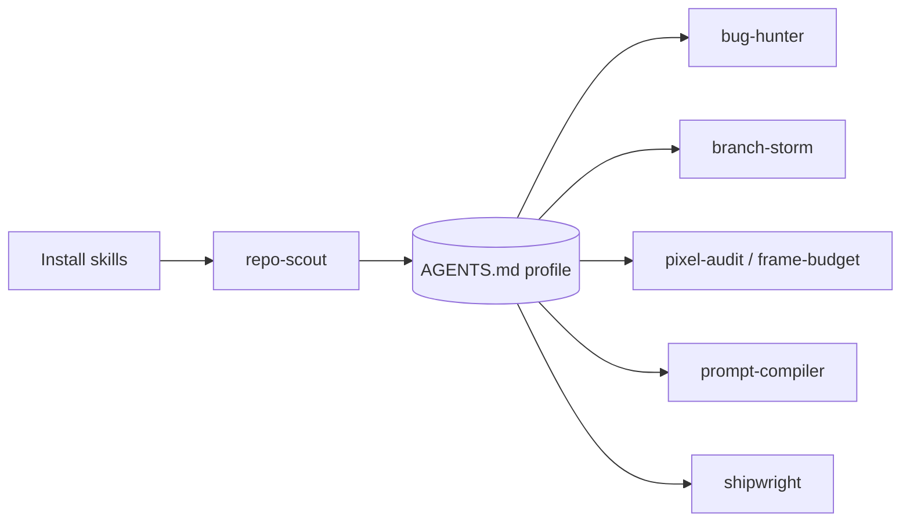

# Skills

Agent skills for everyday Flutter, Next.js and Laravel work. They follow the open `SKILL.md` format, so they work in Claude Code, Codex, Cursor and other agents that support skills.

## Skills

| Skill | Use it to | Trigger |
|---|---|---|
| `repo-scout` | Detect the stack and write `AGENTS.md` with a verified project profile. Run once per project | Manual |
| `bug-hunter` | Debug with a red/green feedback loop, ranked hypotheses and a regression test | Automatic |
| `branch-storm` | Brainstorm options or stress-test a plan, ending in a recommendation | Automatic |
| `pixel-audit` | Review a UI design or frontend code: hierarchy, accessibility, platform fit | Automatic |
| `frame-budget` | Audit Flutter and mobile apps: jank, rebuilds, accessibility, architecture | Automatic |
| `shipwright` | Commit, push and open a PR or MR on GitHub, GitLab or Bitbucket | Manual |
| `prompt-compiler` | Turn a rough prompt into a precise, checkable one | Automatic |

"Manual" skills have side effects, so they only run when you call them.

## Start a new project

1. Install the skills (below).
2. Run `repo-scout` once. It writes `AGENTS.md` (read by every agent) and a `CLAUDE.md` that points to it.
3. Every other skill reads the Profile block in `AGENTS.md`, so none of them re-interview you about stack, commands, git host, commit style or tracker.



## Installation

All skills:

```bash
npx skills@latest add kirubel12/skills
```

One skill:

```bash
npx skills@latest add kirubel12/skills/bug-hunter
```

## Working style

- Terse by default. Say "explain" or "go deep" for more.
- A skill asks at most one question at a time, and always offers a default you can accept with "ok".
- Heavy audits have a quick mode for narrow questions and a full mode for reviews, and the full mode stops for your decision before implementing.

## Evals

`evals/evals.json` has realistic prompts and expectations for each skill, plus prompts that should and should not trigger it. Run each prompt with and without the skill and compare.

## Credits

Built from ideas in public skill collections: the feedback-loop-first debugging approach and the writing guidance in Matt Pocock's `mattpocock/skills`, the PR body format from Dex Horthy's show-me skill (HumanLayer), and the skill-writing guidance in Anthropic's `skill-creator`.

## License

MIT
