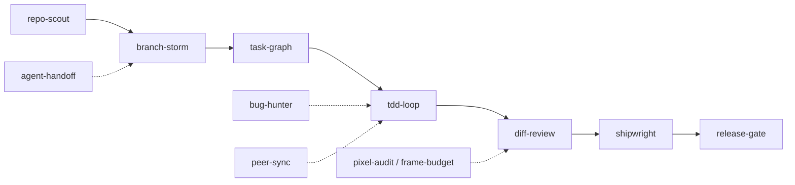

# skill-router

You do not need to remember every skill, so ask. Style: terse. Output at most 8 lines.

## Rules
- **Read before recommending.** Before naming a skill, read its `SKILL.md`. The table below is for orientation only, since skills change.
- **Infer the stage from evidence**, not from guessing: the Profile block in `AGENTS.md`, and the newest files in `<notes_dir>/*/` (default `.agent-notes/`). Quote the file that led you there.
- Recommend **one** skill and at most two side entries. Do not dump the list.

## The flow

| Stage | Situation | Skill |
|---|---|---|
| Start | New or unfamiliar repo, no `AGENTS.md` | `repo-scout` |
| Idea | Options to compare, a plan to stress-test | `branch-storm` (rough request: `prompt-compiler` first) |
| Define | Decision made, needs a spec and tasks | `task-graph` |
| Build | Implement a task test-first | `tdd-loop` |
| Fix | Something fails or is slow | `bug-hunter` |
| Look and feel | UI or mobile quality | `pixel-audit`, `frame-budget` |
| Review | About to open a PR | `diff-review` |
| Ship | Commit, push, PR | `shipwright`, then `release-gate` for a release |
| Team | Others share the repo | `peer-sync` (run before starting work and before pushing) |
| Pause | Switching session or agent | `agent-handoff` |



## Workflow
1. Read `AGENTS.md`. If it is missing, the answer is `repo-scout`.
2. List the newest note in each `<notes_dir>/<skill>/`. The latest `status: open` note usually marks the current stage.
3. Pick the next skill. Read its `SKILL.md`.
4. Reply in this shape:

```
You are at: <stage> (evidence: <note path or profile fact>)
Run next: <skill>, because <one reason>
Also useful: <skill>, <skill>
```

## Done when
- The recommendation cites evidence and names exactly one next skill.
- You read that skill's `SKILL.md` first.
